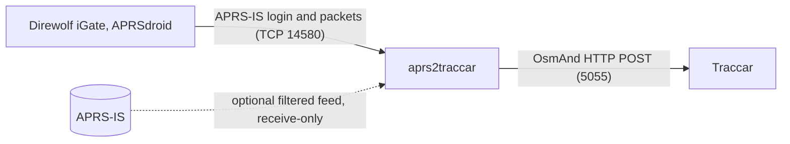

# aprs2traccar

An APRS-IS compatible server that accepts APRS packets from local clients
(iGates, APRSdroid, other APRS-IS clients) and forwards station positions and
status reports to [Traccar](https://www.traccar.org/) through its
[OsmAnd protocol](https://www.traccar.org/osmand/).



The bridge only receives: it sends clients nothing but `#` server lines, and
sends APRS-IS nothing but the uplink login.

## Requirements

- Rust toolchain with edition 2024 support (developed with Rust 1.99), or Docker.
- A Traccar server with the OsmAnd protocol port reachable (5055 by default).

## Running

```sh
cargo run --release -- --config aprs2traccar.toml
```

Without `--config`, built-in defaults apply. Log verbosity follows `RUST_LOG`
(default `info`), e.g. `RUST_LOG=aprs2traccar=debug`. SIGINT and SIGTERM stop
the process gracefully (see [Delivery](#delivery)).

Requests to Traccar honor `HTTP_PROXY`, `HTTPS_PROXY` and `NO_PROXY`; when a
proxy is set, add the Traccar host to `NO_PROXY` unless it should be used.

### Docker

```sh
docker build -t aprs2traccar .
docker run -d --name aprs2traccar --stop-timeout 15 -p 14580:14580 \
  -v "$PWD/aprs2traccar.toml:/etc/aprs2traccar/config.toml:ro" aprs2traccar
```

The image runs as UID 10001, so the configuration file must be readable by
that user. Inside the container, `traccar.url` must name Traccar's address as
seen from the container (e.g. a Compose service name), not `127.0.0.1`.
`--stop-timeout 15` leaves headroom over the default 10-second flush on
shutdown.

## Configuration

TOML with three optional sections; unknown keys are rejected.
[`aprs2traccar.example.toml`](aprs2traccar.example.toml) lists every key.

| Key | Default | Meaning |
|---|---|---|
| `server.listen` | `0.0.0.0:14580` | APRS-IS listener address |
| `server.server_call` | `APRS2TRC` | Server identity in `# logresp` and keepalive lines |
| `server.allowed_logins` | `[]` | Logins allowed to connect (case-insensitive); empty allows any |
| `server.login_timeout_secs` | `30` | Time to send the login line |
| `server.keepalive_secs` | `20` | Interval of `#` keepalive lines |
| `server.client_timeout_secs` | `172800` | Disconnect after this long without input |
| `traccar.url` | `http://127.0.0.1:5055/` | OsmAnd endpoint; must not contain a query string |
| `traccar.request_timeout_secs` | `10` | Per-request timeout |
| `traccar.queue_capacity` | `10000` | Buffered reports; oldest dropped when full |
| `traccar.max_attempts` | `5` | Failed requests before a report is dropped |
| `traccar.shutdown_grace_secs` | `10` | Time to flush the queue on shutdown |
| `uplink.enabled` | `false` | Pull a filtered feed from APRS-IS |
| `uplink.server` | `rotate.aprs2.net:14580` | Upstream APRS-IS server |
| `uplink.callsign` | — | Login callsign (required when enabled) |
| `uplink.filter` | — | Server-side filter (required when enabled) |
| `uplink.idle_timeout_secs` | `120` | Reconnect after this long without input |

## Traccar setup

- Each station is a Traccar device whose identifier is the source callsign
  with SSID, uppercased (e.g. `N0CALL-9`). Traccar rejects reports for unknown
  devices; the bridge drops them and logs a summary at most once a minute
  (each rejection at debug level).
- To create devices automatically, set `database.registerUnknown` to `true` in
  `traccar.xml`. Its default `database.registerUnknown.regex` (`\w{3,15}`)
  rejects the `-` of an SSID, so also set it, e.g. to `[A-Z0-9-]{3,15}`. With
  the uplink enabled, every station matching the filter then becomes a device.
- Leave `osmand.speed` unset: the bridge sends knots, the OsmAnd default.
- Traccar shows a device as unknown after `status.timeout` (600 s) without
  data. Many APRS stations beacon less often; raise it if that matters.
- `filter.outdated` makes Traccar discard the bridge's position-less reports.

## Clients

Clients log in with their callsign and its APRS-IS passcode. Direwolf
(`direwolf.conf`, 13023 being the passcode for N0CALL):

```
IGSERVER bridge.example.lan:14580
IGLOGIN N0CALL-10 13023
```

APRSdroid: use the APRS-IS TCP connection with server
`bridge.example.lan:14580` and your callsign and passcode.

Server behavior:

- Login: `user CALL pass PASSCODE [vers SOFTWARE VERSION] [filter ...]`
  within `server.login_timeout_secs`, answered with
  `# logresp CALL verified|unverified, server APRS2TRC`. Logins equal to
  `server.server_call` or outside `server.allowed_logins` are refused.
- Only verified logins may send packets; packets from unverified logins are
  ignored.
- Filters and other `#` lines from clients are ignored. The server sends a
  `#` keepalive every `server.keepalive_secs` and never sends packets, so
  Direwolf's IS-to-RF gating stays idle.
- Lines over 512 bytes are dropped; clients idle for
  `server.client_timeout_secs` are disconnected.

## What is forwarded

Position reports (uncompressed, compressed and Mic-E, with or without
timestamp, including positions after beacon text) and status reports.
Messages, objects, items, weather-only reports, telemetry and queries are not
forwarded; weather stations' positions are, without the weather data.

- Third-party packets (`}`) are unwrapped and attributed to the inner source.
- Packets with `qAZ` in the path are ignored.
- A packet repeating the source, destination (SSID ignored) and information
  field of one seen in the previous 30 seconds is a duplicate and dropped,
  whichever path or client it arrived through.

OsmAnd parameters:

| Parameter | Value |
|---|---|
| `id` | Source callsign with SSID, uppercased |
| `timestamp` | Packet timestamp (`z` and `h` formats, resolved near the receive time), else the receive time |
| `lat`, `lon` | Position; omitted for status reports and 0°,0° positions |
| `speed` | Knots, from course/speed data |
| `bearing` | Course in degrees |
| `altitude` | Metres, from `/A=`, compressed altitude or Mic-E |
| `accuracy` | Metres, for positions with ambiguity |

Attributes stored with the Traccar position:

| Attribute | Value |
|---|---|
| `aprsSymbol` | Symbol table and code, e.g. `/>` |
| `aprsComment` | Position comment |
| `aprsStatus` | Status text |
| `aprsMicE` | Mic-E message, e.g. `En Route` |
| `alarm` | `sos` for the Mic-E Emergency message, which raises a Traccar alarm |
| `aprsPath` | Packet path |
| `aprsIgate` | iGate from `qAR`/`qAO` or a trailing `,I`, else the client login when it relayed another station |

Reports without coordinates are attached by Traccar to the device's last
location. They are sent only for devices with a position report in the
previous 24 hours, tracked in memory, because Traccar would otherwise store
them at 0°,0°.

## Delivery

- Reports are sent one at a time, in order.
- HTTP 2xx: delivered. 4xx: rejected and dropped. 5xx and timeouts: retried
  with backoff from 1 s to 60 s, and dropped after `traccar.max_attempts`
  failed requests. Connection failures are retried without counting, so
  reports wait while Traccar is down.
- The queue holds `traccar.queue_capacity` reports in memory and drops the
  oldest when full. Nothing persists across restarts.
- On SIGINT or SIGTERM the bridge closes client and uplink connections, then
  flushes the queue for up to `traccar.shutdown_grace_secs`.

## Uplink

With `uplink.enabled`, the bridge logs in to `uplink.server` as
`uplink.callsign` with passcode `-1` (unverified, receive-only) and
`uplink.filter`, and forwards matching reports like packets from local
clients.

- Use your own callsign with an SSID; it identifies the bridge to server
  operators.
- Keep the filter narrow, e.g. `b/N0CALL*` for your stations or
  `r/lat/lon/km` for an area; see the
  [APRS-IS filter guide](https://www.aprs-is.net/javAPRSFilter.aspx). Each
  received report costs a Traccar request, even for stations without a device.
- The bridge reconnects after `uplink.idle_timeout_secs` without data and
  after errors, waiting from 5 s up to 5 minutes between attempts.

## Security

- The APRS-IS listener has no real authentication. Passcodes derive from the
  callsign by a public algorithm, so anyone who can reach the port can submit
  positions for any callsign. Expose it only on a trusted LAN or VPN, firewall
  the port and set `server.allowed_logins`.
- Traccar's OsmAnd endpoint is unauthenticated by design; use an `https://`
  `traccar.url` when the path to Traccar is untrusted.

## Development

| Task | Command |
|---|---|
| Build | `cargo build` |
| Test | `cargo test` |
| Lint | `cargo clippy --all-targets -- -D warnings` |
| Format | `cargo fmt` (check: `cargo fmt --check`) |
| Type-check | `cargo check --all-targets` |
| Container image | `docker build -t aprs2traccar .` |
